<div align="center">


# Domi

**Home-visit diaries that refill themselves.**

The diary for healthcare that comes to the patient's home: eye care, hearing,
foot care, dental, physio, blood tests, nursing and therapy assessments. When a
patient cancels, Domi works out who on the waiting list could take the slot. It
either hands the office a ranked call list (many home-visit patients never answer
a text), texts the best match and books the first yes, or books them straight in.
It plans each clinician's route by real road times, tracks PCSE notice for NHS
sight tests, and takes referrals without paperwork.

Made by YSB Ventures Ltd · [domi.ysbdesigns.uk](https://domi.ysbdesigns.uk) · demo at [app.domi.ysbdesigns.uk](https://app.domi.ysbdesigns.uk/?brand=domi)


</div>

<br/>

> [!NOTE]
> **Reading this without a technical background?** Start at *The problem*, *What's
> in it* and *One cancellation, end to end*. Those three explain what Domi is and
> what it does for a home-visit service. Everything after *How the
> pieces fit* is for whoever maintains the code.

### How to read the diagrams

Every picture in this file uses the same four colours, and they always mean the
same thing. The connectors animate, so you can see which way the information
actually travels.

| | Means |
| :--- | :--- |
| 🟩 **Forest, apricot border** | Domi itself: our code |
| 🟢 **Pale mint** | Built and working in the demo today |
| 🟨 **Sand, dashed border** | In development: not built, not sold as built |
| ⬜ **Stone** | A person, or something outside Domi |

---

## The problem, in one picture

A home-visit practice loses more to a cancellation than a clinic does. The
clinician is already out on the road, the gap is too short to fill by ringing
round, and the people on the waiting list who would have taken it never hear
about it.



Plenty of systems keep a diary. What Domi does differently is **act on the gap**:
it works out who fits it (home at that time, close enough, the visit fits the
time including the drive, and the rules allow it), then does what the practice
has chosen. That's a ranked call list for the office, an offer by text that books
the first yes, or booking the best match straight in. It also books new visits **by the road**,
putting them where they add the least driving, weighed against how soon the
patient needs to be seen.

> [!WARNING]
> **NHS sight tests can't fill a same-day gap.** In England, an NHS sight test at
> home needs a pre-visit notification (PVN) to PCSE. One or two patients at an
> address need at least 48 hours' notice (weekends and bank holidays don't count).
> Three or more at one address, such as a care home, need 3 weeks. PCSE won't take
> a notification more than 8 weeks ahead. Shorter notice needs the ICB's approval
> first. So Domi never offers an NHS sight test for a gap inside its notice
> period, and it refuses a booking that can't meet it unless the office records
> the ICB's approval. A gap today goes to a glasses delivery, a repair, a
> follow-up or a private exam, none of which need a notification. Each NHS test
> goes on a *PCSE notifications* list with its deadline and every field PCSE
> Online asks for, ready to copy. The office still lodges it there by hand and
> records the PVN reference back in Domi for the GOS 6 claim (`server/pvn.js`).
> Scotland, Wales and Northern Ireland have their own rules, which Domi doesn't
> model yet.

> [!TIP]
> **The practice keeps its own name.** Patients see the practice's name in every
> text, on the booking page and on invoices, never "Domi". In the demo the sample
> practice is the invented *Aire Valley Eyecare*, and the office can change it
> (Waiting list → *Texts are signed*), so a prospect can see the demo with their
> own name.

---

## Who it's for

Every home-visit service has the same hard part: a round of patients spread
across towns, cancellations that leave a gap nobody can fill in time, and
referrals arriving on paper. Domi does that part. Each service then gets its own
visit types, rules and records. The website's *Who it's for* section says the
same, with the same honesty about what isn't built.

| Service | Status | What's specific to it |
| :--- | :--- | :--- |
| **Domiciliary eye care** | Built for it: the demo is an eye-care practice | PCSE's 48-hour notice for NHS sight tests; eye tests only to optometrists; glasses deliveries fill same-day gaps; prescriptions on the phone |
| **Hearing care** | Ready to set up | Hearing tests, fittings, wax removal and aid reviews as visit types; audiogram records set up with the practice. *Not built:* Noah 4 |
| **Foot care** (podiatry, chiropody, foot health) | Ready to set up | Nail-care rounds refilled and planned. *Coming next:* repeating visits every 6–8 weeks |
| **Dental care at home** | Ready to set up | Homes and care homes, carers and capacity noted. *Not built:* dental charting |
| **Physiotherapy and rehab** | Ready to set up | Short-notice discharges slot into cancellations. *Coming next:* a course of sessions booked at once |
| **Home blood tests** | Ready to set up | Mornings-only patients stay in the morning when routes are planned. *Not built:* a lab drop-off stop |
| **Nursing at home** | Ready to set up | Offline notes, the route on a street map, every record view logged. *Not built:* medicines and wound charts |
| **Therapy assessments** (OT, speech and language) | Ready to set up | Referrals from families, GPs and social workers through one form |

*Ready to set up* means everything common to home visits works today (refills,
route planning, booking by drive time, the referral form, patient import, the
offline phone app, two-factor sign-in, the audit log), and that service's visit
types are configured with the practice (`server/domain.js`). Don't let anyone
describe a *Ready to set up* service as built for it.

---

## What's in it



> [!IMPORTANT]
> **Everything in green is built, tested and working in the demo. Domi is not yet
> used by a practice, and has no customers.** The demo keeps its data in memory
> and resets itself; it holds only invented patients. A live environment is
> running in London (Fly.io plus Supabase Postgres, see *Two ways to run*), set up
> for a first pilot practice. It holds no patients until that pilot is signed and
> the paperwork in *Before real patients* is done. Features in sand are shown in
> the app with a *Soon* badge and say plainly that they aren't built.

| | |
| :--- | :--- |
| **Office view** | Every clinician's diary for any day this week, a week grid showing how full each round is, the waiting list, and every text sent. Cancel any visit, today or later in the week, to start a refill. Fits a laptop or a tablet |
| **Clinician view** | Phone-first. Today's round with drive times, patient records (alerts, last prescription, glasses, history), quick note chips, *On my way* (texts the patient), *Arrived*, *Complete visit* |
| **Refill engine** | Hard rules: only an optometrist for eye examinations (not a dispensing optician), NHS sight tests only with 48 hours for PCSE, texts only to patients who take them (those who asked for calls are listed for the office to ring and book in one click), same-day OK, fits the free time, morning/afternoon availability, inside or next to the clinician's area. Ranking: clinical priority, then local, days waiting, preferred clinician. Each candidate shows the reasons |
| **Three ways to fill a cancellation** | Chosen in Settings. **Phone them** (for practices whose patients don't text; the demo's default is *Text an offer*): the office gets a ranked call list, best match first, with numbers ready, and logs *no answer*, *not interested* or *booked* in one tap. Every call is counted for the pilot. **Text an offer**: patients reply YES, as below. **Book instantly**: the best text-able match is booked straight in and told by text. The text options stay available even when a practice works by phone |
| **Confirmation calls** | `server/calls.js`. Each visit gets three calls: **CC1** when it's booked (the date only), **CC2** in the week before (a 3-hour arrival window worked out from the planned route), and **CC3** on the working day before (date, time and address). Each can be ticked off, marked *no answer* (it stays on the list) or sent as a text with the same words. A visit that has had its CC3 skips the automatic reminder |
| **Offers that respect the clock** | Days or hours away: one person at a time (patients who need 24 hours' notice qualify for later days), with room for several rounds. Under an hour of slack: the top three at once, first YES wins, and the others are told it's gone. Too close to confirm anyone: the slot is left open rather than wasted on someone who can't be ready |
| **Patients cancel by text** | A patient texting CANCEL cancels the visit and starts the refill, with no staff involved. In the demo, the office plays the patient's phone |
| **Cancellation link for families** | Every reminder carries a private link, and the office can copy one for any booked visit to send to a relative who doesn't text. `/cancel/<practice code>/<token>` shows the visit with the patient's initials only, cancels it once, and starts the refill. Too late (the clinician is on the way) it says to call instead |
| **Patients** | Office only. Find anyone by name, postcode, phone or date of birth, and open their record: details, booked visits (move, cancel or copy the family link from there), waiting-list places and history. Edit any detail: a new address re-works that round's drive times and tells the clinician; the activity log names the fields changed, never the values |
| **Move a visit** | One step instead of cancel-and-rebook: the same search as booking, with the visit's own time counted as free. The patient gets one text (or a call, if that's what they asked for), each clinician affected is told, and an NHS sight test's PCSE notification is cancelled and lodged again for the new time, never inside 48 hours |
| **Fill a gap by hand** | Click any free slot in a diary to see everyone who'd fit, best first, including patients who asked to be phoned (their number is right there). Book whoever says yes: they're confirmed, the clinician's phone updates, and anyone with a text offer out hears it's gone |
| **Record a visit for a clinician** | When a clinician couldn't update the app, the office records *Visit completed* (with a note, raising the invoice, with no "on the way" text) or *Nobody in* (which withdraws the PCSE notification and can put the patient back on the waiting list as *Soon*). Only once the visit's time has passed |
| **Team & hours** | Office only. Add clinicians and office accounts. On a live practice, each new person is emailed a single-use invitation (7 days) to choose their own password and set up their authenticator, so nobody else ever knows either. *Reset sign-in* stops a lost phone or forgotten password at once, signs that person out everywhere and sends a new link (24 hours). Only a hash of each link is stored (`server/invites.js`). In the demo, people can sign in straight away. Set each clinician's role, area, postcode areas, starting postcode and working hours per weekday (or a day off): booking, refills, route planning and the utilisation report all stay inside them, and the diary shades the rest. Changes that would strand a booked visit are refused with the visit named. Switching someone off signs them out on every device and keeps their history |
| **Patient data rights (UK GDPR)** | From the record: download everything held about a patient (subject access), or erase their details on request. Erasure is refused while a visit is booked and for anyone already seen, because clinical and NHS claim records must be kept for at least 7 years; otherwise their details go from records, texts and the activity log, and an anonymous row keeps the diaries adding up |
| **Book a visit** | Pick a patient (or type in a new one), the visit type and when they're home. Domi searches the whole week for every gap where the visit fits, including the drive in and on to the next patient, and ranks them by the extra driving, weighed against how soon it is. Booking texts the patient and appears on the clinician's phone. If nothing fits, one click puts them on the waiting list |
| **Income panel** | Recovered income, cancellations refilled, average time to refill and income still unfilled, from the office's own fee per visit |
| **Day-before reminders** | Every visit tomorrow gets a reminder text at the practice's reminder time (17:00 by default). A CANCEL reply refills that slot a day ahead |
| **Route planning** | *Plan routes* (every clinician, any day) or *Plan the best route* (one clinician). Visits that haven't started are put in the order that drives least, from the clinician's home base and back. Every order is tried for up to 7 visits in a half-day; beyond that, nearest neighbour then 2-opt. Mornings stay mornings and afternoons stay afternoons; today nothing moves inside half an hour; each visit keeps its time slot where it can. A plan has to save at least 10 minutes. The office sees what it saves and who moves first; applying it texts each patient whose time changed and tells the clinician. `server/planner.js` |
| **Referral form** | `/refer/<practice code>`, linked from the practice's website instead of a callback form or documents. Patients, family, carers, care homes and GPs fill it in: the patient, the condition behind the home visit ("housebound" alone is refused, because the GOS 6 needs the condition), NHS entitlement, what's needed, when they're home, and consent. Sudden sight changes get NHS 111 / A&E advice on the spot and are flagged. Referrals wait under *New referrals*; accepting one creates the patient record and a waiting-list place and texts whoever gave a mobile |
| **Facebook leads** | People who fill in the form on the practice's Facebook ads arrive under *Facebook leads* within seconds, with their answers, how long they've waited for a call, and a flag if they're already a patient. Each is emailed a thank-you with the practice's office hours (set in the same panel) as it arrives. The office calls and marks *Called*, *Visit booked* or *Not interested*, with a note. A connector (Zapier or Make's Facebook Lead Ads trigger, or Meta's own webhook) posts each lead to `/api/public/<practice code>/leads`; flat form answers and Meta's `field_data` are both understood. `/ad-form/<practice code>` is a test version of the ad form for trying it out; it posts nothing to Facebook. `server/leads.js` |
| **Towns and postcodes** | Every form asks for town, then postcode area, then the rest of the postcode, from the towns the practice covers (`server/regions.js`), with *Somewhere else* for the odd exception. Imports flag postcodes outside those towns |
| **Route map** | Each clinician's day on a street map (OpenStreetMap, faded so the route stands out): numbered pins in visiting order, the route along the roads when road routing is available (dashed straight lines when not), and a matching numbered list with each drive; tapping a row opens that stop on the map. Offline, the phone shows a simple drawing of the same route instead. Map tiles come from OpenStreetMap's servers, which see the area being viewed but never names; before real patients, use a UK-hosted tile provider under a data processing agreement |
| **Patient booking page** | `/book/<practice code>`: large text, one question at a time. Only offers times from tomorrow that add 20 minutes of driving or less, and never shows other patients' details. NHS sight tests start two days out, for the PCSE notice. Glasses deliveries stay with the office, because they wait for the lab |
| **Import patients** | Office only. Upload a CSV saved from Google Sheets or Excel (up to 5,000 rows). Domi recognises the columns (you can change any), tidies names, UK dates, phones and postcodes, and checks every row before anything is saved: rows without a name or a valid postcode are skipped, possible duplicates (same mobile, or name with postcode or date of birth) are skipped, and warnings flag a landline-only patient (phoned, not texted) or a missing or generic home-visit reason. Patients due a sight test within a fortnight join recalls and the refill pool. The file isn't kept, and the audit log records counts, never names. `server/importer.js` |
| **PCSE notifications** | `server/pvn.js`. Each NHS sight test visit (one address on one day) gets its notice rule: 48 working hours, 3 weeks for three or more at one address, never more than 8 weeks ahead. *Lodge* appears with the deadline and the PCSE Online form's fields laid out to copy (premises type, patients, eligibility and early-retest codes). The office records the PVN reference back for the GOS 6 claim. A cancellation or move adds *Cancel* or re-lodges it, so the notification and the claim still match. Bookings that can't meet the notice are refused unless the ICB's approval is recorded. Sending to PCSE automatically waits on PCSE accepting Domi as a connected system |
| **Working alongside Opticabase** | Opticabase stays the record for eye tests and claims. A daily CSV export imports cleanly, matched by Opticabase ID: new patients are added, changed details updated, and the next exam Opticabase worked out becomes the recall. A row whose ID belongs to someone else is flagged, never merged. Every booking, move and cancellation made in Domi goes on a *Copy to Opticabase* list for the office to copy across and tick off (*Done in Opticabase*, or *Mark all as done*). The two systems can't talk to each other yet, so that copying is done by hand |
| **Pilot results** | `server/pilot.js`. The practice's own baseline, the targets agreed at signing, and each week since go-live, judged on the last four complete weeks, with before-and-after charts. Measures: cancelled slots refilled (%), phone calls per refill, office hours on scheduling (entered weekly), miles per visit (from mileage claims, not Domi's own routes) and visits per week. Every number comes from the diary or from what the office records, never from an estimate |
| **The calendar** | `server/calendar.js`. Real UK dates on a live practice: weekends, bank holidays and the practice's closure days are closed, and booking limits keep visits inside the opening days. The demo's "today" is always Monday 12 October 2026 at 10:20 |
| **Recalls** | Patients due a sight test (yearly from 70) or a pressures recheck join the refill pool, so a cancellation near them goes to someone due anyway. The office can text them the booking page |
| **Mileage & utilisation** | Per clinician and day: time booked, driving time, estimated miles and their value at HMRC's 45p rate. Downloads as CSV |
| **Invoicing** | Completing a visit raises an invoice at the practice's price for that visit type (£0 = none: NHS sight tests are claimed on a GOS 6, and glasses are charged when ordered). Mark paid by card, cash or transfer, void, or print. No VAT is added |
| **Offline clinician app** | A service worker keeps the app on the phone. Today's round and records are saved on the device; notes and visit updates made without signal sync in order when it returns. Signing out wipes the copy |
| **Sign-in** | Password (scrypt) then a six-digit authenticator code (TOTP). Codes can't be reused; wrong passwords and wrong codes both count, and 5 lock the account for 15 minutes. Sessions end after 2 hours idle or 12 hours, and survive a restart on a live practice. In the demo, the office can see every signed-in device and sign a lost phone out; on a live practice, use *Reset sign-in* |
| **Live updates** | Server-Sent Events. A change on the laptop reaches the phone within a second |
| **What's coming** | Features not built yet sit where they'll live, with a *Soon* badge, and *What's coming* lists them all, split into next and later, with no dates. The list is `ROADMAP` in `public/app.js` |
| **Under the hood** | Demo only. Architecture, the cancellation journey, live API traffic, the event stream, offers, the audit log and a database browser. Switched off on a live practice |

---

## One cancellation, end to end

What happens between a patient cancelling and the clinician's phone showing the
new visit, and which file does each step.



The booking, the texts and the live update are one transaction (`tx()` in
`server/service.js`): texts and events are only released once the database has
committed, so a patient is never told about a visit that didn't save, and two
YES replies can't both win.

---

## How the pieces actually fit



### Why there are no dependencies

Domi uses only what ships with Node 22: `node:http` for the server,
`node:sqlite` for the database and `node:crypto` for passwords and codes. The
browser side is plain HTML, CSS and JavaScript with no build step. Nothing to
install means nothing to keep patched, a tiny attack surface, and a demo that
starts in a second.

### Why every visitor gets a private demo

`server/sandbox.js` gives each visitor their own in-memory copy of the sample
practice, with a clock that starts at 10:20 on a Monday, using
`AsyncLocalStorage` so every request sees only its own demo. People opening the
same link can't see or break each other's demo. A phone joins a laptop's demo by
scanning the QR code under **Open on phone**, a one-time sign-in link. Demos are
cleared after 3 hours idle or when the server restarts.

### Two ways to run

| | **Demo** (the default) | **Live** (`DEMO_MODE=0` and `DATABASE_URL` set) |
| :--- | :--- | :--- |
| Where | Render, at `app.domi.ysbdesigns.uk` | Fly.io London (`domi-live`, `fly.toml`), with Postgres on Supabase in London (eu-west-2) |
| Data | A private sample practice per visitor, in memory, deleted after 3 hours idle | Real practices: each held in memory and written through to its own Postgres schema (`p_<code>`) before the server answers |
| Sign-in | Demo shortcuts (shown password, code helper, QR pairing) | No shortcuts. Staff choose their own password and authenticator from an emailed invitation |
| Machines | Any | Exactly one, because each practice is held in memory |

A server with a database never runs the demo shortcuts, even if `DEMO_MODE` goes
missing from its settings: only an explicit `DEMO_MODE=1` turns them on there
(`server/auth.js`). The live set-up, adding a practice and its first admin, new
columns and backups are in [docs/LIVE-DATABASE.md](docs/LIVE-DATABASE.md).

### Where patient data goes



| It leaves when… | What goes | Where |
| :--- | :--- | :--- |
| A drive time is worked out | Postcodes only, never names | postcodes.io and the router (OSRM in the demo, openrouteservice on a live practice) |
| A live practice changes anything | The changed rows | Supabase Postgres, London, over an encrypted connection with the certificate checked |
| A text is sent, with Twilio set up | The phone number and the message | Twilio. Without keys, texts stay in the demo's outbox |
| A clinician works offline | Today's round and its records | That phone's browser storage, wiped on sign-out |
| Someone visits the website | Nothing | No cookies, analytics or third-party requests |

---

## The stack, in four layers


| Layer | What and why |
| :--- | :--- |
| **Node 22**, no npm packages | `node:http`, `node:sqlite`, `node:crypto`. Nothing to install or patch |
| **`server/refill.js`** | The ranking and offer rules as pure functions, unit-tested on their own |
| **Vanilla front end** | `public/app.js`, `app.css`, no framework, no build. Self-hosted fonts, so pages make no third-party requests |
| **Service worker** | `public/sw.js` keeps the clinician app working without signal |
| **Drive times** | postcodes.io places postcodes; OSRM gives road times, cached, with a straight-line fallback |
| **Texts** | `server/notify.js`: a demo outbox, or real Twilio when keys are set |
| **Render** · Fly.io · Supabase | Render runs the demo (`render.yaml`). Fly.io London runs the live service from the `Dockerfile` (`fly.toml`), saving to Supabase Postgres in London (`server/live.js`, `server/pgstore.js`) |
| **GitHub Actions → Pages** | Builds and publishes the website from `main`, checks it every 6 hours |

---

## This repository

```
server/          the API, sign-in, booking service, refill rules, drive times, texts (start here)
public/          the app: office and clinician screens, patient booking page, service worker
site/            the marketing website, published to domi.ysbdesigns.uk
test/            engine, database, API, sign-in, travel and website tests
docs/HOSTING.md        UK hosting options, and what's needed before real patients
docs/LIVE-DATABASE.md  the live service: Postgres layout, security, adding a practice, staff sign-in
design/                the Figma build script for the colours and logo
assets/diagrams/       the diagrams in this file, as source and as SVG
scripts/               builds the website and the diagrams; live-admin.js (practices and admins); restore-test.sh
```

Needs **Node 22.5 or newer**. There's nothing to install:

```bash
npm start           # http://localhost:3000
npm test            # unit, API and website tests
npm run site        # builds the website into _site/
```

- App: `http://localhost:3000`
- Technical view: `http://localhost:3000/under-the-hood` (office sign-in only)
- Brand and design tokens: `http://localhost:3000/brand`

Sign in with a password and then a six-digit code from an authenticator app. In
the demo, the sign-in screen shows the password and can fill the code in for you.

### Deploying the demo

The demo needs a server, so it runs on Render, not GitHub Pages. `render.yaml`
is a Blueprint, so Render reads the settings from the repo:

1. Sign in at [dashboard.render.com](https://dashboard.render.com) with GitHub and give Render access to this repo.
2. **New → Blueprint**, choose this repo and `main`, then **Apply**.
3. About two minutes later it's at its `onrender.com` address. The build runs the tests, so a failing test stops a bad deploy.

The live service is **domi-bolton**, at **`https://app.domi.ysbdesigns.uk`** (a
custom domain: a CNAME `app.domi` → `domi-hearing-demo.onrender.com` at one.com),
and it still answers at `https://domi-hearing-demo.onrender.com`. It deploys
from `main`. It sets `DEFAULT_BRAND=hvo`, so the plain address opens in a
practice's own branding for a showcase. `/?brand=domi` gives the neutral demo,
which is what the website links to. Remove the variable in Render (Environment)
when the showcase is over.

On the free plan it **sleeps after 15 minutes without visits** and takes about
30–60 seconds to wake. Open it a few minutes before a meeting. Every wake
starts the demo story afresh. Pages send `noindex`. For a UK-hosted copy, see
[docs/HOSTING.md](docs/HOSTING.md): Fly.io London, using `fly.toml` and the `Dockerfile`.

### Deploying the live service

The live service is the Fly.io app **`domi-live`** in London (`lhr`). It does
**not** deploy from `main` by itself: merging to `main` updates only the demo and
the website. To ship to live:

1. Build the image from `main` (the build runs the tests, so a failing test stops it) and push it to `registry.fly.io/domi-live`, tagged `pilot-<n>`.
2. `fly deploy --image registry.fly.io/domi-live:pilot-<n>`, then check `/api/health` reports the database as up.
3. Run **one machine only** (`fly scale count 1`). On a deploy, the old machine gets SIGTERM and has 10 seconds to finish saving to Postgres.

Secrets (`DATABASE_URL`, `DATABASE_CA_CERT`, `ORS_API_KEY`, Twilio, Resend) are
Fly secrets, never in `fly.toml`. **Changing a live practice's settings in the
database** (`domi.practices.settings`) needs a restart straight afterwards.
Otherwise the running server can write its own copy back over the change.

### Deploying the website

`.github/workflows/pages.yml` runs on every push to `main` that touches the site,
and publishes:

| Address | What it is |
| :--- | :--- |
| `domi.ysbdesigns.uk/` | The website: what Domi does, the two-minute tour, the feature deck, what's built and coming, questions, and the site's privacy policy |
| `/404.html` | The "page not found" page |

**Settings → Pages → Source** must be **GitHub Actions**, not a branch. Optional
repository variables (**Settings → Secrets and variables → Actions → Variables**):
`DEMO_URL` (default `https://app.domi.ysbdesigns.uk/?brand=domi` for the website's button; the 6-hourly check uses the bare domain), `EMAIL` (default
`yameen@ysbdesigns.uk`) and `SITE_URL` (default `https://domi.ysbdesigns.uk`).
`site-check.yml` loads the website and the demo every 6 hours and fails, which
makes GitHub email you, if one is down.

> [!CAUTION]
> **A deploy can say it succeeded and change nothing.** Pages names each
> deployment after its commit. If a deployment of that commit already exists
> (for example from before switching off "Deploy from a branch"), GitHub keeps
> the old one and still reports success. Push a new commit that touches the site
> and it publishes properly. **The custom domain lives in two places**: the
> CNAME record at the domain's DNS and **Settings → Pages → Custom domain**.
> Change one and change the other in the same sitting.

The website's pictures (`site/shots/`) are real screenshots from the running
demo, with device frames drawn around them; retake them after changing the
app's screens. The tour (`site/film/domi-tour.mp4`, with `poster.webp`) is
encoded with `+faststart` so it starts before it has fully downloaded.

### Where things live

| What you want to change | File |
| :--- | :--- |
| Who is offered a cancelled slot, and in what order | `server/refill.js` |
| Booking, texts, audit, invoices, reminders | `server/service.js` |
| The words in every patient text | `server/service.js` (search for `sendSms`) |
| Drive times and the fallback | `server/travel.js` |
| Passwords, codes, sessions, phone pairing | `server/auth.js` |
| The sample practice, its patients and diary | `server/db.js` |
| Demo defaults: practice name, fee, prices, reminder time | `server/sandbox.js` |
| Visit types and who can do them | `server/domain.js` |
| PCSE notice rules and the PVN form fields | `server/pvn.js` |
| Confirmation calls (CC1, CC2, CC3) | `server/calls.js` |
| Pilot baseline, targets and weekly results | `server/pilot.js` |
| Dates, bank holidays and closures | `server/calendar.js` |
| Staff invitations and sign-in resets | `server/invites.js` |
| Saving live practices to Postgres | `server/live.js`, `server/pgstore.js` |
| Importing patients (including Opticabase exports) | `server/importer.js` |
| A practice's own branding, towns and sample diary (opened with `/?brand=<id>`) | `server/brands.js`, `server/regions.js`, `server/seed-nw.js` |
| Route planning rules | `server/planner.js` |
| The office and clinician screens | `public/app.js`, `public/app.css` |
| What's marked *Soon*, and the roadmap | `ROADMAP` in `public/app.js` |
| The patient booking page | `public/book.html` |
| Working offline | `public/sw.js`, and the offline module in `public/app.js` |
| Colours, type and the logo | `public/app.css`, `public/brand.html`, `design/` |
| The website | `site/index.html`, built by `scripts/build-site.js` |

### Drive times

Each booking option is labelled **Road route** or **Estimated**.

- **Postcodes** are placed with [postcodes.io](https://postcodes.io) (free; Ordnance Survey and ONS data).
- **Road times** come from an [OSRM](https://project-osrm.org) table request covering every stop in the diary, with 30% added for daytime traffic and 4 minutes for parking.
- **Caching and fallback:** results are cached; requests time out after 3 seconds, and after a failure the router is left alone for a minute. Until then, straight-line estimates are used, so booking never waits on a third party.
- **The sample diary** uses road times saved from OSRM (`server/routes-seed.json`), so it shows real routes even offline.
- **Live lookups** need `ROUTING_PROVIDER=osrm`, which `render.yaml` sets for the demo. Locally and in the tests, new postcodes are estimated.
- **The live practice** uses [openrouteservice](https://openrouteservice.org) (`ROUTING_PROVIDER=ors` with an `ORS_API_KEY`): its free plan allows commercial use and gives road distances as well as times, so the mileage report uses road miles. Domi keeps under the free daily allowance (matrix and directions requests are counted) and falls back to estimates when it's used up or the key is missing. The map credits openrouteservice, as its licence requires.

The public OSRM demo server is fair use only, so it isn't used for real patients.

### Sending real texts

```bash
TWILIO_ACCOUNT_SID=... TWILIO_AUTH_TOKEN=... TWILIO_FROM=+44... npm start
```

Point the Twilio number's incoming-message webhook at `https://<host>/api/sms/inbound`.
That endpoint only exists when Twilio is configured, and it rejects any request
without a valid `X-Twilio-Signature` (it uses `PUBLIC_URL`, or `RENDER_EXTERNAL_URL` on Render).

### Settings

| Variable | Default | |
| :--- | :--- | :--- |
| `PORT` | 3000 | |
| `OFFER_MINUTES` | 20 | How long a patient has to reply |
| `DEMO_MODE` | `1`, unless `DATABASE_URL` is set | `0` removes the demo shortcuts: no password on screen, no code helper, no QR sign-in, no demo-only endpoints. With a database, the shortcuts are off unless this is exactly `1` |
| `DATABASE_URL` | none | Postgres (Supabase, London). Turns on live practices (`server/live.js`) |
| `DATABASE_CA_CERT` | none | The database's CA certificate, so the encrypted connection is checked |
| `PRACTICE_CODE` | none | On a live server, the practice people sign in to |
| `MAX_SANDBOXES` | 100 | Private demos kept in memory at once |
| `ROUTING_PROVIDER` | `estimate` | `osrm` or `ors` for live road routes and postcode lookups |
| `OSRM_URL` | public demo server | Your own OSRM server |
| `ORS_API_KEY` | none | openrouteservice key, for `ROUTING_PROVIDER=ors` (a Fly secret, never in `fly.toml`) |
| `DEFAULT_BRAND` | none (`domi`) | The brand the plain address opens in (`server/brands.js`). `/?brand=<id>` always overrides it |
| `MARKETING_URL` | `https://domi.ysbdesigns.uk/` | The website: "Powered by Domi" links here, and the demo's privacy policy and terms (`/privacy`, `/terms`) are the website's |
| `CF_BEACON_TOKEN` | none | Cloudflare Web Analytics (cookieless, so no consent banner). Never added to the cancellation page, whose address holds a private token |
| `PUBLIC_URL` | the address in use | The address cancellation links in texts point to |
| `LEADS_KEY` | none | When set, a connector posting leads must send it, as `?key=` or an `X-Domi-Key` header |
| `RESEND_API_KEY`, `EMAIL_FROM` | none | Send the leads' thank-you emails for real through Resend, from an address on a domain verified there (its SPF and DKIM records). Without them, emails stay in the demo's outbox |

The website's build takes the same kind of settings from the repository's Actions variables: `DEMO_URL`, `EMAIL`, `SITE_URL`, `WEB3FORMS_KEY` (the contact form; without it the form opens an email instead) and `CF_BEACON_TOKEN`.

**Web basics, both sites.** Privacy policy and terms (`site/privacy/`, `site/terms/`), a contact form with a thank-you page (`site/thanks/`), breadcrumbs on every inner page, a sitemap and robots.txt (built by `scripts/build-site.js`), PNG icons for phones (`public/*.png`), link previews, and a custom 404 on each site. The demo redirects HTTP to HTTPS and sends HSTS, gzips text, and can't be framed by other sites. Its public forms (referral, booking) check each field as people fill them in and drop bots silently: a hidden box people never see, and a minimum time on the form.

### Security in the demo

- **Sign-in:** password plus authenticator code. Wrong codes count towards the lockout as well as wrong passwords. Per-connection limits use the real client address behind Fly's proxy (`Fly-Client-IP`). Sessions are server-side in an HttpOnly cookie. CSRF protection uses an app-only header plus an Origin check.
- **Demo-only endpoints:** the text simulator and debug views answer only in the demo. On a live practice, the Facebook-lead endpoint needs an office session for that practice, and the patient booking page shows "switched off" when online booking is off.
- **Data at rest:** invitation and reset links are never kept in the stored email copy. The phone's offline copy expires after 12 hours. The service worker never caches cancellation or invitation pages. CSV exports are guarded against spreadsheet formulas.
- **Isolation and access:** a private sandbox per visitor; role checks on every endpoint (a clinician only opens patients on their round or in their patch).
- **Data integrity:** validated state transitions, a double-booking guard, and texts and live events released only after the database commits.
- **Audit:** every change and every record a person opens is logged.
- **Inbound texts:** Twilio signature verification. **Static files:** path-traversal-safe, all self-hosted.

---

> [!NOTE]
> **Showing a particular practice.** `/?brand=<id>` opens a demo in that practice's name, colours, typeface
> and logo (loaded from their own website, never copied here), set in the towns they cover with a full
> invented week: 50 patients, three clinicians, referrals waiting. Without the parameter, the demo is the
> default invented practice in Leeds. The choice is remembered on that device until another `?brand=` is opened.

## Showing the demo (about 8 minutes)

1. On the laptop, click **Sarah Lane (office)**, then **Fill in the current code** and **Verify**. Click **Open on phone** and scan the QR code: your phone signs in as Amira in the same demo.
2. Optional: under Waiting list, type the prospect's practice name into **Texts are signed**.
3. Click **Peter Dunn, 11:00** (a glasses delivery) → *Cancel and refill this slot*. The visit is 40 minutes away, so the top three are asked at once. Gerald is urgent but ruled out: his is an NHS sight test, and PCSE needs 48 hours' notice. Irene is ruled out too: she's only free in the afternoons.
4. Reply **NO** as Sylvia, then **YES** as Margaret: her new varifocals get fitted today. Geoffrey is told it's gone and keeps his place.
5. Hold up the phone: the banner, the new visit and the text are already there. The income panel shows the visit recovered.
6. Click **Ken Ollerton, 13:30** → *Text CANCEL as Ken*. It refills with nobody in the office touching it, one patient at a time because there's more time. Ken's was an NHS sight test, so **PCSE notifications** now says to cancel his notification.
7. Click **Book a visit**, choose **Irene Battye** (afternoons only, a repair), and find slots: every gap this week, ranked by the extra driving. Book the top one and show the phone. Then try **NHS sight test** for anyone: nothing before Wednesday, and Tom (a dispensing optician) never appears.
8. Click **Week** to show how full each round is. Cancel a Thursday visit: with days to spare, it asks one person at a time.
9. Click the pin on Amira's column for her route map. In **Reminders**, click *Send now*, then reply CANCEL as one of tomorrow's patients: the slot refills a day ahead.
10. Click **Patient booking page**, open it on the phone and book as a patient. The office sees it arrive.
11. On the phone, turn on airplane mode, complete a visit and add a note, then turn signal back on: both sync. Open **Invoices** for the invoice that raised.
12. Click **What's coming**: what's planned, and that nothing on the list pretends to work yet.
13. Open **Under the hood**: the audit log, the offers table and the rows just written.

---

## When something goes wrong



### Who fixes what

| It is… | Who | How |
| :--- | :--- | :--- |
| The demo in a muddle | **You** | The ↺ (start again) button in the top bar, or wait: it starts afresh when it wakes |
| Drive times marked *Estimated* | **Nobody** | The router is down; Domi falls back and retries after a minute |
| The demo link shows Render's "waking up" screen | **Nobody** | The free plan was asleep; it's ready in under a minute |
| The website shows an old page | **Us** | Push a new commit that touches the site (see *Deploying the website*) |
| A wrong ranking, text or number | **Us** | Reproduce it in a test, fix it, `npm test`, merge |

The contact address is `yameen@ysbdesigns.uk`, set as the website's `EMAIL` variable.

---

## Before real patients

> [!WARNING]
> **The demo is not for real patient data.** It keeps everything in memory, holds
> invented patients only, and says so on the website. [docs/HOSTING.md](docs/HOSTING.md)
> has the detail; the short list is below.

Done:

- **A permanent UK database:** Supabase Postgres in London (Pro plan, daily backups), with a restore tested by `scripts/restore-test.sh`.
- **UK hosting:** Fly.io London, one machine, graceful shutdown on deploy.
- **Real accounts:** `DEMO_MODE=0` on live; staff set their own password and authenticator from an invitation, and *Reset sign-in* replaces a lost phone or password.
- **Secrets** in Fly's secret store, never in this repo.
- **Routing** for a live practice set up on openrouteservice (its free plan allows commercial use), with estimates as the fallback. The `ORS_API_KEY` Fly secret still has to be added; until then, live drive times are estimates.
- **ICO registration.**

Still to do before the first real patient:

1. **The paperwork with the practice:** the DPIA (drafted), the data processing agreement, and a check that their DSPT is in place.
2. **Data processing agreements** with each processor in use: Supabase, Fly.io, openrouteservice, and Twilio and Resend once texts and emails are switched on.
3. **Encrypt the offline copy** on clinicians' phones, and require a passcode on those phones.
4. **Hardening on the list:** a content security policy, a least-privilege database role, an off-platform backup, and branch protection with CI on `main`.
5. **For NHS buyers:** Cyber Essentials, and the DSPT if Domi itself holds NHS contracts.

---

## Before you change any copy

> [!CAUTION]
> **Never claim a feature that isn't built.** Anything not in the demo is marked
> *Soon* in the app and *Not built yet* on the website, until it's real. The same
> goes for customers: Domi has none yet, so no testimonials, logos or "trusted
> by" lines. A practice in a pilot isn't named anywhere public, and its results
> aren't quoted, until it has agreed in writing. Demo figures (such as the
> driving a route plan saves on a sample day) must always say they're from the demo.

Three more that catch people out:

- **Patients see the practice, not Domi.** Every patient text, the booking page and invoices use the practice's name (`settings.practice`). Domi's own name belongs on the staff screens.
- **The demo practice is invented.** *Aire Valley Eyecare* turned up no UK practice of that name in a web search before use; check again before showing it widely. Don't swap in a real practice's name, staff or patients.
- **Patient texts are service messages, not marketing.** Keep them about the visit. Anything promotional sent to patients needs their consent under PECR.

British English throughout: *colour*, *programme*, *licence* (the noun).

---

## The diagrams

Seven SVGs, and the connectors animate. GitHub renders mermaid but can't animate
it, so these are built rather than inlined. The sources stay in the repo as text,
so a diagram is still something you can edit and diff:

```bash
assets/diagrams/*.mmd             # the source, one file per diagram
node scripts/build-diagrams.mjs   # regenerates the SVGs
```

The build script holds the palette and the animation in one place. It declares
the colours light-first and redefines them under `prefers-color-scheme`, so the
diagrams follow GitHub's theme, and it keeps a `prefers-reduced-motion` guard,
so anybody who has asked their machine for less movement gets a still picture.
It fetches mermaid-cli with `npx`, so Domi itself still has no dependencies.

> [!NOTE]
> **Do not add a `font-family` override to that stylesheet.** Mermaid sizes every
> box for the font it measured with *before* the stylesheet is added, so changing
> the face afterwards clips the last line of a label.

Rendering needs a Chromium. If the machine has one already:

```bash
PUPPETEER_EXECUTABLE_PATH=/path/to/chrome node scripts/build-diagrams.mjs
```

---

## Licence

All rights reserved, YSB Ventures Ltd. Not open source. The fonts in
`public/fonts/` are under the SIL Open Font Licence.
